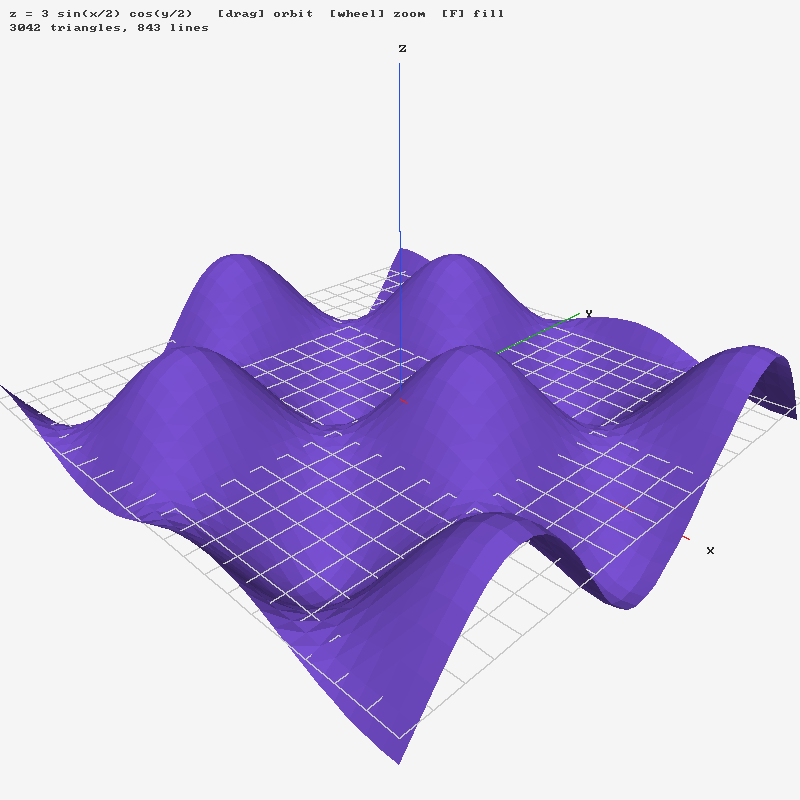
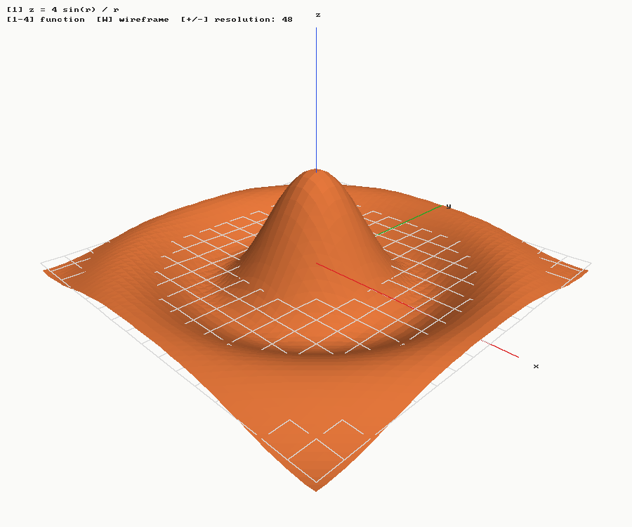
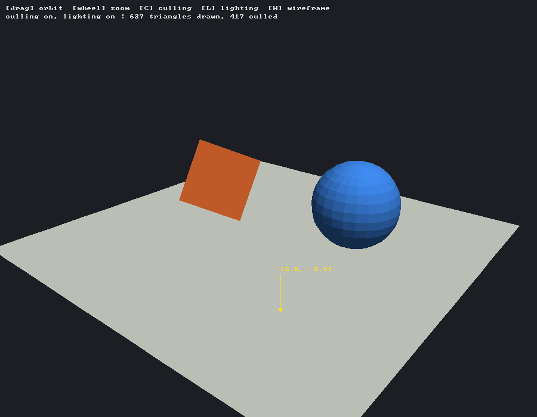
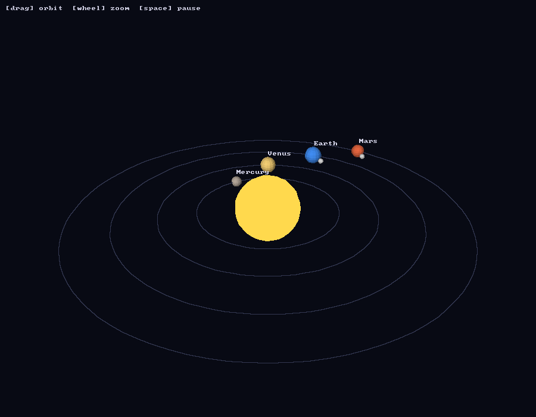
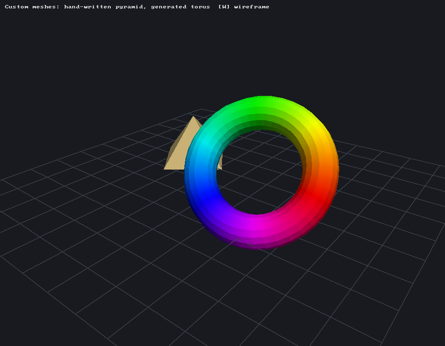
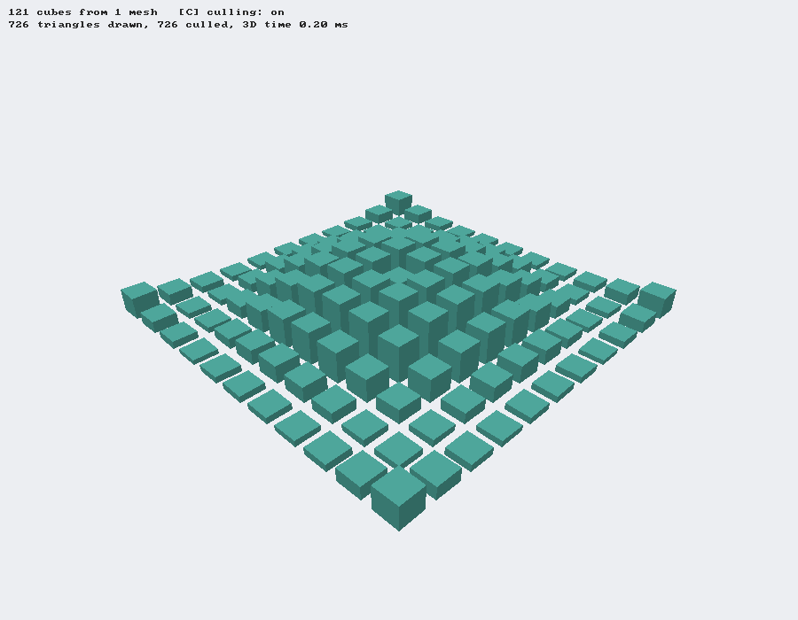

# SDL3_r3d

[](https://github.com/tanodev0/SDL3_r3d/actions/workflows/ci.yml)
[](LICENSE.txt)

3D drawing for SDL3 without writing a single shader.

You want a rotating cube, a function plot or a wireframe scene. With plain SDL3, the 2D `SDL_Renderer` can't do it, and the GPU API asks you for shaders, pipelines and buffers first. SDL3_r3d gives you a third option: you describe the scene in 3D and draw it with the `SDL_Renderer` you already use.

The library runs the 3D math on the CPU (view and perspective matrices, near-plane clipping, lighting, depth sorting) and draws the result with `SDL_RenderGeometry` and `SDL_RenderLine`. It works with every SDL3 render backend, including the software renderer.


*`examples/showaxes.c`, with the camera moved by `R3D_OrbitCamera`.*

> **Unofficial.** SDL3_r3d is a third-party library built on top of SDL3. It is not part of SDL and the SDL project does not endorse it.

## Is it for you?

Use SDL3_r3d for:

- function plots, math and physics visualizations
- debug views, editors and tools
- simple 3D games, prototypes and learning projects

Use the SDL GPU API or a 3D engine for textures, smooth shading, per-pixel depth or tens of thousands of triangles per frame. See [Limitations](#limitations).

## Features

- **Drawing:** lines, points, filled triangles, convex polygons, text labels placed in 3D
- **Meshes:** your own vertices and indices, or ready-made cube, sphere and plane
- **Surfaces:** plot `z = f(x, y)` filled or as a wireframe; undefined samples (NaN, infinity) are skipped, so `1/x` just works
- **Helpers:** ground grid, colored X/Y/Z axes
- **Camera:** perspective camera, orbit and zoom with one call
- **Lighting:** flat directional lighting with ambient light
- **Back-face culling** for closed meshes
- **Mouse picking:** turn a screen position into a 3D ray
- **Math:** `R3D_Vec3` and `R3D_Mat4` with translate, scale, rotate (any axis), invert, look-at and perspective
- **Correct clipping** of lines and triangles that pass behind the camera
- **Frame statistics:** triangles and lines drawn, culled and clipped
- **SDL-style API:** `bool` results with `SDL_GetError()`, memory through `SDL_malloc`, C and C++

## Quick start

```c
#include <SDL3_r3d/SDL_r3d.h>

R3D_Context *r3d = R3D_CreateContext(renderer);
R3D_Mesh *cube = R3D_CreateCubeMesh(2.0f, (SDL_FColor){ 1.0f, 0.5f, 0.2f, 1.0f });

R3D_Camera camera = {
    .position = { 8, -10, 6 }, .target = { 0, 0, 0 }, .up = { 0, 0, 1 },
    .fovy = 0.8f, .near_plane = 0.1f, .far_plane = 100.0f,
};
R3D_SetLighting(r3d, true, (R3D_Vec3){ -1, 0.5f, -2 }, 0.3f);
R3D_SetCulling(r3d, true);

/* every frame */
SDL_RenderClear(renderer);

R3D_BeginFrame(r3d, &camera);
R3D_DrawGrid(r3d, 20, 1.0f);
R3D_DrawAxes(r3d, 5.0f);

R3D_Mat4 model = R3D_Mat4RotateZ(SDL_GetTicks() / 1000.0f);
R3D_DrawMesh(r3d, cube, &model);

R3D_EndFrame(r3d);              /* sorts and draws everything */
SDL_RenderPresent(renderer);

/* at the end */
R3D_DestroyMesh(cube);
R3D_DestroyContext(r3d);
```

You can keep drawing 2D on top after `R3D_EndFrame()`: SDL3_r3d draws into your renderer and leaves its draw color as it found it.

## Examples

Every example is a single commented C file in [`examples/`](examples). Drag with the mouse to orbit and use the wheel to zoom in all of them.

| | |
|---|---|
|  **[`showaxes.c`](examples/showaxes.c)**: the minimal setup. Grid, labelled axes and a lit surface. |  **[`plot.c`](examples/plot.c)**: a function plotter with four surfaces, adjustable resolution and holes where `f` is undefined. |
|  **[`meshes.c`](examples/meshes.c)**: built-in meshes, lighting, back-face culling and mouse picking on the floor. |  **[`solarsystem.c`](examples/solarsystem.c)**: transform hierarchies. Each moon follows its planet. |
|  **[`custommesh.c`](examples/custommesh.c)**: your own meshes. A hand-written pyramid and a generated torus with per-vertex colors. |  **[`cubes.c`](examples/cubes.c)**: one mesh drawn 121 times with different matrices, with frame time and culling statistics. |

## Building

You need CMake 3.16 or newer and a C compiler (GCC, Clang or MSVC). CI builds and tests every commit on Linux, macOS and Windows.

If SDL3 is installed, CMake uses it. If not, CMake downloads and builds SDL3 for you, so a fresh clone builds with no extra steps.

```sh
cmake -S . -B build
cmake --build build
ctest --test-dir build --output-on-failure
./build/showaxes      # or: meshes, plot, solarsystem, custommesh, cubes
```

CMake options:

| Option | Default | |
|---|---|---|
| `SDLR3D_SHARED` | `ON` | build a shared library (`OFF` for static) |
| `SDLR3D_EXAMPLES` | `ON` | build the examples |
| `SDLR3D_TESTS` | `ON` | build the tests |
| `SDLR3D_FETCH_SDL` | `ON` | download and build SDL3 when it is not installed |

On Windows the programs land in `build/bin/Release/` (or `build/bin/` with single-config generators), next to `SDL3.dll`.

The tests run without a window: they use SDL's dummy video driver and the software renderer.

## Using it in your project

After `cmake --install build`:

```cmake
find_package(SDL3_r3d 0.1 REQUIRED CONFIG)
target_link_libraries(your_app PRIVATE SDL3_r3d::SDL3_r3d)
```

Or copy the repository into yours:

```cmake
add_subdirectory(external/SDL3_r3d)
target_link_libraries(your_app PRIVATE SDL3_r3d::SDL3_r3d)
```

## API overview

The full documentation lives in [`include/SDL3_r3d/SDL_r3d.h`](include/SDL3_r3d/SDL_r3d.h).

| Area | Functions |
|---|---|
| Context | `R3D_CreateContext`, `R3D_DestroyContext`, `R3D_BeginFrame`, `R3D_EndFrame`, `R3D_GetStats` |
| State | `R3D_SetDrawColor`, `R3D_SetCulling`, `R3D_SetLighting` |
| Drawing | `R3D_DrawLine3D`, `R3D_DrawPoint3D`, `R3D_DrawTriangle3D`, `R3D_DrawPolygon3D`, `R3D_DrawText3D`, `R3D_DrawGrid`, `R3D_DrawAxes`, `R3D_DrawSurface` |
| Meshes | `R3D_CreateMesh`, `R3D_CreateCubeMesh`, `R3D_CreateSphereMesh`, `R3D_CreatePlaneMesh`, `R3D_DrawMesh`, `R3D_DrawMeshWireframe`, `R3D_DestroyMesh` |
| Camera | `R3D_OrbitCamera`, `R3D_ProjectPoint`, `R3D_ScreenToRay` |
| Vectors | `R3D_Vec3Add`, `Sub`, `Scale`, `Dot`, `Cross`, `Length`, `Normalize`, `Lerp` |
| Matrices | `R3D_Mat4Identity`, `Multiply`, `MultiplyVec4`, `TransformPoint`, `Transpose`, `Invert`, `Translate`, `Scale`, `RotateX/Y/Z`, `Rotate`, `Perspective`, `LookAt` |

## Conventions

- Right-handed coordinates. You choose the up axis with `R3D_Camera.up`; the examples use Z up.
- Angles in radians.
- Matrices are column-major (`m[column * 4 + row]`) and multiply column vectors: `R3D_Mat4Multiply(a, b)` applies `b` first.
- Front faces are counter-clockwise seen from the front. The built-in meshes face outwards.
- Each `R3D_Context` belongs to one renderer and one thread.

## Limitations

SDL3_r3d sorts whole primitives by their average distance to the camera (the painter's algorithm) instead of testing depth per pixel. This has consequences:

- Triangles that cut through each other can't both be right; one of them wins.
- A huge triangle next to a small object can sort wrong. Split big surfaces into smaller pieces: `R3D_CreatePlaneMesh` takes a subdivision count, and `R3D_DrawGrid` already draws one cell at a time.
- Everything runs on the CPU. A few thousand triangles per frame are fine; hundreds of thousands are not.
- Lighting is flat (one brightness per triangle) and there are no textures.

## Roadmap

- Textured triangles (`SDL_RenderGeometry` already supports them)
- Smooth (per-vertex) lighting
- Splitting intersecting triangles (BSP) for exact ordering
- More primitives: cylinder, cone, torus, arrows

## License

zlib, the same license as SDL. See [LICENSE.txt](LICENSE.txt).

## Bibliography

- [Cross product (Wikipedia)](https://en.wikipedia.org/wiki/Cross_product)
- [Sutherland–Hodgman polygon clipping (Wikipedia)](https://en.wikipedia.org/wiki/Sutherland%E2%80%93Hodgman_algorithm)
- [Painter's algorithm (Wikipedia)](https://en.wikipedia.org/wiki/Painter%27s_algorithm)
- [Rodrigues' rotation formula (Wikipedia)](https://en.wikipedia.org/wiki/Rodrigues%27_rotation_formula)
- [OpenGL projection matrix (songho.ca)](https://www.songho.ca/opengl/gl_projectionmatrix.html)
